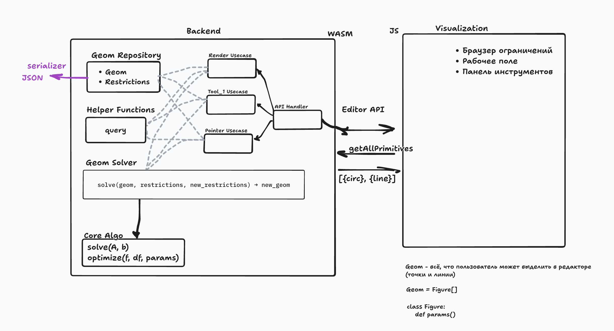

# Вариационный геометрический решатель (кафедра РК6, ЛР № 1)

## Запуск и отладка

Нужны Node.js 20.19+ (ветка 20) или 22.12+, npm, CMake 3.14+ и Emscripten в `PATH`.

```bash
./dev.sh
```

Откройте [http://127.0.0.1:5173](http://127.0.0.1:5173) или адрес, который напечатал Vite. Скрипт устанавливает зависимости из `package-lock.json` при первом запуске. Vite собирает debug-WASM при старте, подхватывает изменения JS и CSS и перезагружает страницу после пересборки C++. Порт можно задать через `./dev.sh --port 5174`.

- **JavaScript.** В DevTools → Sources ставьте точки останова в модулях `web/src/`.
- **C++/WASM.** Debug-сборка содержит DWARF. Для точек останова в C++ установите расширение **C/C++ DevTools Support (DWARF)** для Chrome и разрешите ему доступ к файловым URL. После перезагрузки откройте исходник в Sources и воспроизведите действие в редакторе. Например, кнопка «Пересчитать СЛАУ» вызывает код из `src/CoreAlgo.cpp`. [Руководство Chrome](https://developer.chrome.com/docs/devtools/wasm)
- **clangd.** `.clangd` выбирает базу команд компиляции из `.build/wasm/debug`. Её создаёт `./dev.sh` или `./build_wasm.sh debug`. Для `tests/` используется нативная база из команды ниже.

## Сборка и тесты

```bash
npm ci
npm run build
npm run preview
```

`npm run build` собирает release-WASM и готовый сайт в `web/dist/`. Для отдельной сборки ядра используйте `./build_wasm.sh`. Файлы `geom_solver.mjs` и `geom_solver.wasm` появятся в `.build/wasm/release/`.

```bash
cmake -S . -B .build/native -DCMAKE_BUILD_TYPE=Debug -DCMAKE_EXPORT_COMPILE_COMMANDS=ON
cmake --build .build/native
ctest --test-dir .build/native --output-on-failure
```

Установите `clang-format` и `clang-tidy` из LLVM, чтобы использовать команды проверки кода. CMake также ищет их в стандартных каталогах Homebrew.

```bash
cmake --build .build/native --target format       # форматирует исходники и заголовки
cmake --build .build/native --target format-check # проверяет форматирование
cmake --build .build/native --target tidy         # анализирует ядро и тесты
cmake --build .build/wasm/debug --target tidy     # анализирует ядро и WASM-привязки
```

## Архитектура

Автор схемы — Георгий Жуков.



**Backend (C++17 → WASM).** `GeomRepository` хранит `Geom = Figure[]` и ограничения, сериализует эскиз в JSON. Каждый `Figure` предоставляет `params()`. В редакторе можно выделять точки и отрезки. `HelperFunctions` выполняет поиск по координатам курсора и вычисляет число степеней свободы. `GeomSolver` строит задачу с учётом текущих и новых ограничений. `CoreAlgo` решает СЛАУ методом Гаусса и вычисляет поправки методом Ньютона для системы Лагранжа. Заголовки находятся в `include/`, реализации — в `src/`.

**Editor API.** `ApiHandler` объединяет Render Usecase, Tool_1 Usecase и Pointer Usecase. Привязки в `src/wasm/` экспортируют API. Визуализация получает точки, отрезки, ограничения и диагностику решателя через `getAllPrimitives()`. Поиск, команды редактирования и импорт эскиза передаются в ядро через тот же API. Импорт принимает как прежний браузерный JSON с массивами `points` и `segments`, так и JSON репозитория с массивом `primitives`.

**Visualization (JavaScript, Vite, SVG).** Модули `web/src/` отвечают за рабочее поле, инструменты, браузер ограничений и инспектор матрицы. `sketch-view.js` строит SVG из снимка, который `editor-api.js` получает через WASM. Выбор примитива по координатам выполняет ядро.
